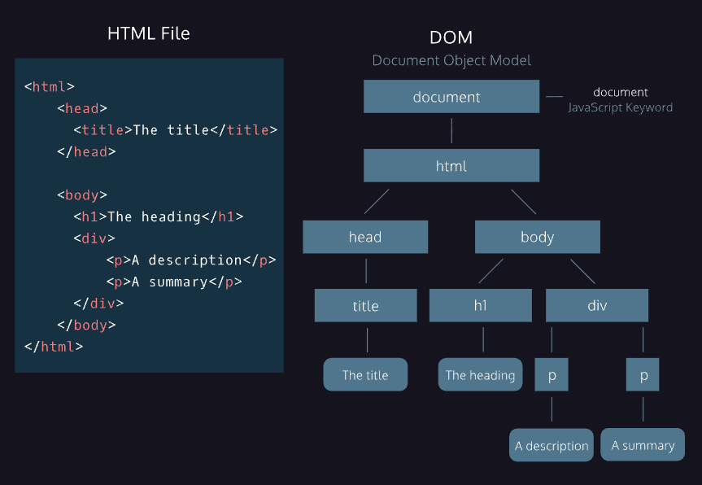

# DOM e JavaScript

O HTML define a estrutura de uma página web usando elementos como blocos de construção. No entanto, o HTML por si só não consegue produzir interatividade. Se HTML e CSS fornecem estrutura e estilo para a página, o JavaScript formece interatividade. O elemento `<script>` permite adicionar código JavaScript a um arquivo HTML.  

A Vinculação de código é preferível devido a um conceito chamado "Separação de Responsabilidades" (Separation of Concerns (SoC)). Em vez de ter um código desorganizado e todo no mesmo arquivo, os desenvolvedores web separam seu código em arquivos diferentes, tornando cada "responsabilidade" mais fácil de entender e mais conveniente quando alterações precisam ser feitas.  

Sendo assim, cria-se um arquivo JavaScript separado e vincula-se esse arquivo ao HTML usando o elemento `script` no final do elemento `body` e usando o atributo `src` para referenciar o arquivo JavaScript.

```html
<body>
    <h1>Hello World</h1>
    <p>This is a paragraph.</p>
    <script src="script.js"></script>
</body>
```

Os navegadores vêm equipados com analisadores HTML que ajudam os navegadores a renderizar os elementos de acordo. Os elementos, incluindo o elemento `<script>`, são analisados por padrão na ordem em que aparecem no arquivo HTML. Quando o analisador de HTML encontra um elemento `<script>`, ele carrega o script e executa seu conteúdo *antes* de analisar o restante do HTML.  

- O analisador HTML NÃO processa o próximo elemento no arquivo HTML até que o elemento `<script>` seja carregado e executado.
- Os scripts são carregados sequencialmente, portanto, se um script depende de outro, eles devem ser colocados exatamente nessa ordem dentro do arquivo HTML.
- O HTML4 introduziu os atributos `defer` e `async` para o elemenbto `<script>`para lidar com o tempo de espera do usuário no site, com base em diferentes cenários.
- O atributo `defer` especifica que os scripts devem ser *executados* após a análise completa do arquivo HTML. Quando o analisador HTML encontra um elemento `<script>` com esse `defer` atributo, ele *carrega o script*, mas *adia a execução* do JavaScript até que termine de analisar os demais elementos do arquivo HTML. Quando um script contém funcionalidades que exigem interação com o DOM, o `defer` atributo é a melhor opção.

```html
<script src="script.js" defer></script>
```
-  O atributo `async` carrega e executa o script de forma assíncrona com o restante da página web. O analisador HTML continuará analisando o HTML enquanto o script é baixado em segundo plano e executado imediatamento após o download. Se não importa exatamente em que ponto o arquivo de script é executado, o carregamento assíncrono é a opção mais adequada, pois otimiza o tempo de carregamento da página da web.
```html
<script src="script.js" async></script>
```


## DOM - Document Object Model

O **_Document Object Model (DOM)_** é um modelo lógico que estrutura o documento HTML como um objeto. O DOM é uma árvore de *"nós"* que representa uma página HTML. Quando uma página da web é carregada, o navegador cria uma representação de árvore do documento HTML. O DOM é implementado pelos navegadores para permitir que o JavaScript *acesse, modifique e atualize* a estrutura de uma página web HTML de forma organizada.

- Um *nó pai* é qualquer nó que seja um ancestral direto de outro nó.
- Um *nó filho* é um descendente direto de outro nó, chamado de nó pai.
- Existem quatro tipos de nós:
  - Nós de texto: são nós que contêm *texto*.
  - Nós de elemento: são nós que contêm *elementos*. Ex: `<p>`
  - Nós de atributo: são nós que contêm *atributos*. Ex: `<p id="my-paragraph">`
  - Nós de nó: são nós que contêm outros nós.
  
 

## Métodos e Propriedades da Interface DOM

**`document`** - nós raiz da árvore DOM. Antes de acessar um elemento específico na página, é necessário acessar a própria estrutura do documento. `document` permite que os script acessem e manipulem os *elementos filhos* da página.  

Ao usar o DOM no seu script para acessar um elemento HTML, você também tem acesso a todas as *propriedades* desse elemento. Isso inclui a capacidade de *modificar o conteúdo do elemento*, bem como seus *atributos* e *propriedades*, que podem variar desde a modificação do texto dentro de um <p> elemento até a atribuição de uma nova cor de fundo para um `<div>`.  

O exemplo abaixo altera o conteúdo do elemento `<h1>` para "Hello World".
```js
document.body.innerHTML = '<h1>Hello World</h1>';
```


### Seletores CSS

Com `document.body` acessamos o elemento `<body>` com a palavra-chave `document`. Mas para acessar um elemento específico sem acessar todo o elemento `<body>`? O DOM nos permite usar *seletores CSS* para selecionar elementos específicos.

*Seletores CSS* definem os elementos aos quais um conjunto de regras CSS se aplica, mas também podemos usar esses mesmos seletores para acessar elementos DOM com JavaScript! Os seletores podem incluir um *nome de tag*, uma *classe* ou um *ID*.

JavaScript possui *métodos* que selecionam elementos com base em sua *classe*, *id* ou *nome de tag*.

- Para selecionar um elemento com base em seu nome de tag, use o método `getElementByTagName()`.
- Para selecionar um elemento com base em sua classe, use o método `getElementsByClassName()`.
- Para selecionar um elemento com base em seu ID, use o método `getElementById()`.
- `querySelector()` nos permite especificar um seletor CSS como uma *string* e retorna o *primeiro elemento* que corresponde a esse seletor. Ex: 
```js
document.querySelector('p');
```